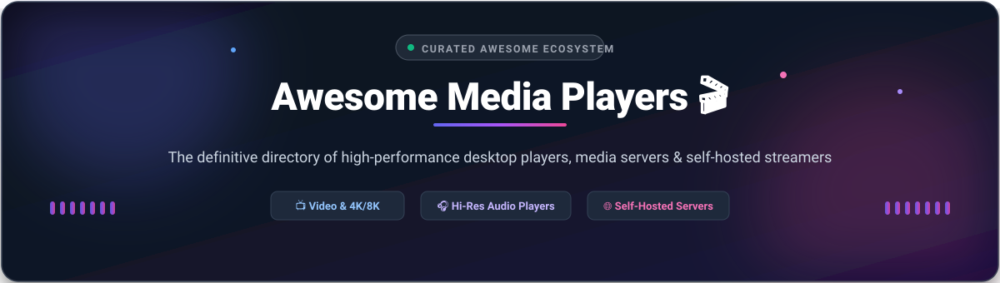

# 🎬 Awesome Media Players 🎧

    

**Curated list of awesome media players, video streamers, cross-platform audio engines, and self-hosted home theater media servers.**

A modern, comprehensive showcase of top SaaS multimedia tools and battle-tested open-source GitHub projects.

[Explore SaaS Platforms](#-saas--hosted-platforms) • [Explore Open-Source Players](#-open-source-github-projects) • [Contributing](#-how-to-contribute) • [Support](#-support)

---

## 📑 Table of Contents
- [📊 Sector Overview & Market Dynamics](#-sector-overview--market-dynamics)
- [☁️ SaaS & Hosted Platforms](#-saas--hosted-platforms)
- [💻 Open-Source GitHub Projects](#-open-source-github-projects)
  - [🏆 Category Heavyweights & Media Servers](#-category-heavyweights--media-servers)
  - [🎧 Dedicated Music & Audio Players](#-dedicated-music--audio-players)
  - [⚡ Lightweight Video & Stream Aggregators](#-lightweight-video--stream-aggregators)
- [🤝 How to Contribute](#-how-to-contribute)
- [💖 Support](#-support)
- [⚠️ Disclaimer](#-disclaimer)
- [📈 Star History](#-star-history)

---

## 📊 Sector Overview & Market Dynamics

The global media player software market is valued at approximately **$4.1B to $5.1B in 2026** (scaling toward over $8.5B by the mid-2030s at a steady 7.5%–7.8% CAGR), while the broader connected digital media player ecosystem exceeds **$17.5B**. 

The sector exhibits **moderate-to-high fragmentation** characterized by distinct niches: proprietary OS giants (Apple QuickTime, Microsoft Media Player) capture passive desktop users, while power users and self-hosters heavily favor modular open-source stacks (VLC, Kodi, Jellyfin, MPV) and hybrid freemium ecosystems (Plex). Market dynamics are defined not by winner-take-all consolidation, but by protocol interoperability, codec efficiency (AV1, HEVC, HDR10), and consumer demand for privacy-focused local media ownership.

---

## ☁️ SaaS & Hosted Platforms

Curated list of commercial and hosted playback solutions, indexed by scale, transparent pricing models, and specific free tier limitations.

| Product | Description | Company Scale (Market Cap / Valuation / Revenue) | Pricing | Free Tier Limit |
| :--- | :--- | :--- | :--- | :--- |
| **[QuickTime Player](https://support.apple.com/quicktime)** | Apple's built-in media player for macOS with video playback, audio recording, screen recording, and basic editing. | Apple: ~$5.0 Trillion Market Cap (~$391B revenue) | **Free** (bundled with macOS / pre-installed on Mac hardware) | **Free forever plan**: Unlimited use bundled with macOS. Full feature set (playback, recording, trim/export) with no watermark or time limits. |
| **[Windows Media Player](https://support.microsoft.com/en-us/windows/get-windows-media-player-817cca05-da25-7f8a-9cf5-8a5b3a4e8b8e)** | Microsoft's built-in media player for Windows 10/11 with local library management, audio CD ripping, and video playback. | Microsoft: ~$3.9 Trillion Market Cap (~$245B revenue) | **Free** (bundled with Windows OS license) | **Free forever plan**: Unlimited personal use bundled with Windows operating system. No expiration, no feature limits, and no ads. |
| **[PotPlayer](https://potplayer.daum.net/)** | Windows video player with extensive codec support, 3D/360-degree video support, hardware acceleration, and subtitle customization. | Kakao Corp.: ~$10.5 Billion Market Cap (~$6.0B revenue) | **Free** for personal use (ad-supported freeware; commercial deployment requires corporate licensing) | **Free forever plan**: Unlimited personal video playback on Windows. No playback restrictions or expiration; commercial distribution/use restricted. |
| **[PowerDVD](https://www.cyberlink.com/)** | Commercial media and Blu-ray/DVD player with 4K/8K playback, TrueTheater AI enhancements, and cloud media casting. | CyberLink Corp.: ~$145 Million Market Cap (~NT$2.4B / $75M revenue) | **$59.99 one-time** (Standard Edition lifetime license); **PowerDVD 365** subscription starts at $54.99/year | **7-day free trial**: 7 days of full premium feature access. After 7 days, reverts to basic playback mode (locks Blu-ray/DVD/ISO playback, 8K video, and TrueTheater AI enhancements). |
| **[Plex](https://www.plex.tv/)** | Polished media server and streaming client with live FAST TV channels, remote media streaming, and multi-device library management. | Plex, Inc.: ~$60M–$65M Annual Revenue ($132M total VC funding raised) | **Plex Pass**: $6.99/month (or $69.99/year); **Lifetime Pass**: $750 (tripled from $250 on July 1, 2026) | **Free forever plan**: Unlimited local playback, media organization, and 600+ ad-supported FAST streaming channels. Hardware transcoding, mobile sync, and remote streaming relay restricted to Plex Pass. |
| **[DivX Pro](https://www.divx.com/)** | High-definition video player, media converter, and casting server with HEVC 10-bit playback and cloud storage integrations. | DivX, LLC: ~$13.3 Million Annual Revenue (Privately held, Fortress Investment Group) | **$13.99 one-time** payment for DivX Pro lifetime upgrade | **Free forever plan**: Unlimited standard DivX Player and Converter usage (ad-supported). Cloud Connect, DTS-HD audio, DFX Audio Enhancer, and ad-free experience require Pro purchase. |
| **[KMPlayer](https://www.kmplayer.com/)** | Versatile media player supporting 4K, 8K, 60FPS playback with built-in codecs, YouTube streaming, and subtitle customization. | Pandora TV: ~$3.55 Million Market Cap (~$9.9M revenue) | **Free** on desktop; Mobile version offers optional in-app purchases starting at **$1.99** | **Free forever plan**: Fully free desktop playback with unlimited watch time and format decoding. Mobile free version includes ads with optional $1.99–$19.99 in-app purchases. |
| **[GOM Player](https://www.gomlab.com/)** | Desktop media player featuring 360-degree VR playback, damaged file playback, codec search service, and subtitle finder. | GOM & Company: ~$4M–$5M Annual Revenue (Private unlisted entity) | **GOM Player+**: ¥1,100–¥2,200 (~$7.50–$15.00) one-time lifetime license; free version is ad-supported | **Free forever plan**: Free personal desktop playback with advertisements. Advanced 4K/UHD playback without ads and AI subtitle generation require GOM Player+ lifetime license. |

---

## 💻 Open-Source GitHub Projects

Curated list of open-source players and servers, sorted by GitHub star count in descending order.

### 🏆 Category Heavyweights & Media Servers

- **[Jellyfin](https://github.com/jellyfin/jellyfin)**   
  🌟 **The free, private Plex alternative.** GPL-2.0 licensed. 100% community-driven self-hosted media server with zero paywalls. Hardware transcoding (NVENC, VAAPI, QuickSync), multi-user profiles, live TV streaming, and cross-platform native clients (Android, iOS, Roku, Apple TV) are all completely free.

- **[IINA](https://github.com/iina/iina)**   
  🍏 **The modern media player for macOS.** GPL-3.0 licensed. Engineered in Swift, tailored for modern macOS aesthetics with Dark Mode, Picture-in-Picture, Force Touch, Touch Bar controls, and seamless MPV backend integration.

- **[LosslessCut](https://github.com/mifi/lossless-cut)**   
  ✂️ **The Swiss Army knife of lossless video and audio trimming.** GPL-2.0 licensed. Electron/Chromium-based ultra-fast lossless video, audio, and subtitle editor built directly on FFmpeg. Cuts, mixes, and trims files instantaneously without re-encoding.

- **[MPV](https://github.com/mpv-player/mpv)**   
  ⚙️ **The minimalist, scriptable power player.** GPL-2.0+ licensed. Lightweight, hyper-fast command-line driven engine with high-quality OpenGL, Vulkan, and D3D11 video output, customizable shaders, and extensive Lua/JavaScript scripting.

- **[Navidrome](https://github.com/navidrome/navidrome)**   
  🎶 **Modern self-hosted music server & streamer.** GPL-3.0 licensed. Ultra-lightweight Golang and React music server compatible with Subsonic/Airsonic clients. Handles immense personal music collections on low-resource devices (like Raspberry Pi) with live transcoding.

- **[FreeTube](https://github.com/FreeTubeApp/FreeTube)**   
  🛡️ **The private YouTube desktop player.** AGPL-3.0 licensed. Open-source privacy-focused YouTube client for Windows, macOS, and Linux that streams videos without tracking, bypasses annoying ads, and stores subscriptions locally.

- **[Kodi](https://github.com/xbmc/xbmc)**   
  📺 **The definitive home theater media center.** GPL-2.0 licensed. Transforms computers, HTPCs, and TVs into full-blown living room entertainment hubs with rich metadata scrapers, PVR/DVR integrations, and thousands of community plugins.

- **[VLC media player](https://github.com/videolan/vlc)**   
  🌍 **The universal playback standard.** GPL-2.0+ licensed. Plays any format, codec, DVD, disc, or network stream without external codec packs. Fully cross-platform across Windows, macOS, Linux, iOS, and Android.

- **[MPC-HC (Nightly / Clsid2 Fork)](https://github.com/clsid2/mpc-hc)**   
  📼 **Lightweight Media Player Classic for Windows.** GPL-3.0 licensed. The actively maintained fork of Media Player Classic - Home Cinema featuring integrated LAV Filters, MPC Video Renderer, and HDR playback on modern Windows systems.

- **[Beets](https://github.com/beetbox/beets)**   
  📚 **The media library manager for music obsessives.** MIT licensed. Powerful CLI and Python library that catalogs your music collection, fixes metadata using MusicBrainz/Discogs, renames files, and transposes album art.

- **[Streamlink](https://github.com/streamlink/streamlink)**   
  📡 **CLI utility that pipes video streams into modern players.** BSD-2-Clause licensed. Extracts video streams from Twitch, YouTube, and other providers and pipes them directly into VLC or MPV for resource-friendly viewing.

### 🎧 Dedicated Music & Audio Players

- **[Musikcube](https://github.com/clangen/musikcube)**   
  📻 **Terminal-based audio engine and streaming library.** BSD-3-Clause licensed. Superb C++ terminal player and audio server for Linux, macOS, and Windows with gapless playback, crossfading, and low memory footprint.

- **[Clementine](https://github.com/clementine-player/Clementine)**   
  🍊 **Modern multiplatform music player & library organizer.** GPL-3.0 licensed. Inspired by Amarok 1.4, featuring fast search, cloud storage playback (Dropbox, Drive), podcast support, and dynamic smart playlists.

- **[Audacious](https://github.com/audacious-media-player/audacious)**   
  🎛️ **Lightweight advanced audio player with Winamp skin support.** BSD-2-Clause licensed. Focused on pristine audio fidelity and negligible CPU usage with drag-and-drop playlists and custom audio effects.

### ⚡ Lightweight Video & Stream Aggregators

- **[mpv.net](https://github.com/mpvnet-player/mpv.net)**   
  🪟 **Modern Windows GUI front-end for MPV.** MIT licensed. Brings MPV's robust playback engine to Windows users with context menus, config dialogs, and intuitive hotkeys.

- **[SMPlayer](https://github.com/smplayer-dev/smplayer)**   
  📺 **Full-featured Qt graphical interface for MPV and MPlayer.** GPL-2.0+ licensed. Remembers playback settings for every individual file, downloads subtitles automatically, and streams YouTube content.

- **[Stremio](https://github.com/Stremio/stremio-shell)**   
  🎬 **Modern streaming video aggregation platform.** GPL-2.0/MIT licensed. Discovers, organizes, and watches video content through an extensible community add-on ecosystem.

---

## 🤝 How to Contribute

Contributions, feature additions, and corrections are warmly welcomed! 🌟

1. 🍴 **Fork the repository** on GitHub.
2. 🌿 **Create a topic branch**: `git checkout -b feature/add-new-player`
3. 📝 **Add or update an entry** in `README.md` (keep descriptions factual, include license, and use correct badge syntax).
4. 🚀 **Commit your changes**: `git commit -m 'Add AmazingPlayer to open-source tools'`
5. 📬 **Open a Pull Request** with a concise summary of the addition.

---

## 💖 Support

Thank you for visiting **Awesome Media Players**! If you find this curated collection helpful in discovering the right player or setting up your media server, please consider supporting the project:

- ⭐ **Star this repository** to help others discover it.
- 🍴 **Fork and share** with your fellow self-hosters and audiophiles.
- ☕ **Buy a coffee / Sponsor**: If you'd like to support ongoing maintenance and new tools discovery, visit the [**GitHub Sponsors Dashboard**](https://github.com/sponsors/ishandutta2007).

---

## ⚠️ Disclaimer

- This is a community-curated list compiled for educational, research, and technical reference purposes.
- Trademarks, product names, and brand logos belong to their respective owners.
- Codec licenses and streaming legalities vary by jurisdiction; please verify software compliance in your jurisdiction before commercial deployment.

---

## 📈 Star History

---

  Made with ❤️ for audiophiles, cinephiles, and self-hosted home theater enthusiasts worldwide.

